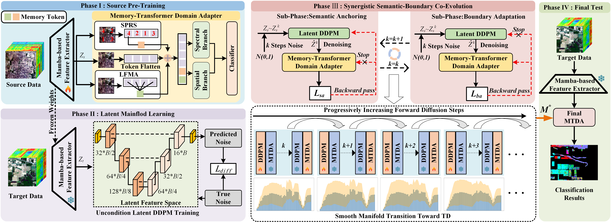

# TGRS_2026_Diff-MEA

**From Generation to Adaptation: Gradual Diffusion Transitions for Cross-Domain Hyperspectral Image Classification**  
*IEEE Transactions on Geoscience and Remote Sensing*, 2026.

[Bobo Xi](https://b-xi.github.io/), [Xinyu Wen](https://orcid.org/0009-0001-7052-0007), [Xiaomeng Tan](https://xm-tan.github.io/), [Jiaojiao Li](https://scholar.google.com/citations?user=Ccu3-acAAAAJ), [Yunsong Li](https://dblp.uni-trier.de/pid/87/5840.html), [Zan Li](https://scholar.google.com/citations?user=FL3Mj4MAAAAJ), and [Paolo Gamba](https://unipv.unifind.cineca.it/resource/person/657174?language=en-US).

[Paper on IEEE Xplore](https://ieeexplore.ieee.org/document/11690676)

<p align="center">
  
</p>

<p align="center"><em>Fig. 1. Overall architecture of Diff-MEA for cross-scene HSI classification.</em></p>

## Abstract

Cross-domain hyperspectral image (HSI) classification via unsupervised domain adaptation (UDA) is practical for Earth observation, yet its performance is often limited by severe distribution shifts. Existing methods typically seek a one-step nonlinear mapping in a highly non-convex optimization space, which risks representation collapse and semantic distortion. To address this issue, we propose a diffusion-guided manifold evolution adaptation (Diff-MEA) framework. Instead of using generative models merely for data augmentation, Diff-MEA reformulates UDA as a continuous manifold evolution process that decouples macroscopic domain gaps into tractable micro-shifts via gradual diffusion transitions. To facilitate this evolution, we introduce a synergistic semantic-boundary co-evolution (SSBCE) mechanism, which alternates between a semantic anchoring (SA) sub-phase to penalize generative drift and a boundary adaptation (BA) sub-phase to accommodate target-shifted manifolds. To realize these phases, a memory-transformer domain adapter (MTDA) integrates salient peak response selection (SPRS) and local feature mean aggregation (LFMA) to construct persistent memory tokens, which serve as robust semantic anchors and support dynamic decision boundary expansion. Extensive experiments on three benchmark datasets demonstrate that Diff-MEA consistently outperforms state-of-the-art methods in handling severe domain gaps.

## Training Process

The workflow comprises four stages:

1. **Source-domain backbone pretraining.** Run `mamba_encoder_pretraining/demo_mamba.py` to train the mamba-based encoder defined in `mamba_encoder_pretraining/backbone.py`. Configure the source dataset in `mamba_encoder_pretraining/utils.py`. The output is the full-model checkpoint `backbone_pretrain.pth`.

2. **Target-domain feature extraction.** Run `mamba_encoder_pretraining/extract_feature.py` with the pretrained backbone. It extracts target-domain latent features without updating backbone parameters and saves `_features_Houston.npy`.

3. **Unconditional diffusion pretraining.** Run `diffusion_pretraining/train_3dconvunet.py` on the extracted features. The U-Net and diffusion objective are implemented in `diffusion_pretraining/unet3d.py` and `diffusion_pretraining/diffusion.py`. Checkpoints are saved as `feature_diffusion_epoch_<epoch>.pt`.

4. **Main adaptation.** Run `Diff_MAE/Houston_main.py` with both pretrained checkpoints. SSBCE generates transitional features, while `SubPhase_SA` and `SubPhase_BA` perform the two adaptation updates.

From the repository root, run:

```bash
python mamba_encoder_pretraining/demo_mamba.py --dataset Houston13 --flag train
# Output: ./backbone_pretrain.pth

python mamba_encoder_pretraining/extract_feature.py --model_path ./backbone_pretrain.pth
# Output: _features_final_20260915_Houston.npy 

python diffusion_pretraining/train_3dconvunet.py
# Output: feature_diffusion_epoch_<epoch>.pt 

python Diff_MAE/Houston_main.py --encoder_model ./backbone_pretrain.pth --unet3d_model ./feature_diffusion_epoch_100.pt
```

The final command assumes that the selected diffusion checkpoint is available in the repository root. If the dataset or training sample size changes, retrain the models and retune the relevant hyperparameters for the new experimental setting.

**Historical features.** `Diff_MAE/Houston_main.py` stores `features_k*.pt` under `10seed_20epoch_features/seed_<seed>/` and revisits these files during training. Before repeating an experiment with the same seed, delete its historical features or pass `--overwrite_seed_features`; otherwise, features from an earlier run could be reused. 

**Implementation notes.** The mamba-based encoder builds on [*S2Mamba: A Spatial-spectral State Space Model for Hyperspectral Image Classification*](https://doi.org/10.1109/TGRS.2025.3530993) ([official code](https://github.com/PURE-melo/S2Mamba)). Diffusion model training refers to [*SpectralDiff: A Generative Framework for Hyperspectral Image Classification with Diffusion Models*](https://ieeexplore.ieee.org/document/10234379) ([official diffusion code](https://github.com/chenning0115/spectraldiff_diffusion)).

## References

If this code is useful in your research, please cite:

B. Xi, X. Wen, X. Tan, J. Li, Y. Li, Z. Li, and P. Gamba, "From Generation to Adaptation: Gradual Diffusion Transitions for Cross-Domain Hyperspectral Image Classification," *IEEE Transactions on Geoscience and Remote Sensing*, vol. 64, Art. no. 5529615, 2026, doi: [10.1109/TGRS.2026.3733406](https://doi.org/10.1109/TGRS.2026.3733406).

```bibtex
@ARTICLE{11690676,
  author  = {Xi, Bobo and Wen, Xinyu and Tan, Xiaomeng and Li, Jiaojiao and Li, Yunsong and Li, Zan and Gamba, Paolo},
  title   = {From Generation to Adaptation: Gradual Diffusion Transitions for Cross-Domain Hyperspectral Image Classification},
  journal = {IEEE Transactions on Geoscience and Remote Sensing},
  year    = {2026},
  volume  = {64},
  pages   = {5529615},
  doi     = {10.1109/TGRS.2026.3733406}
}
```

## Licensing

Copyright © 2026 Bobo Xi and Xinyu Wen.

This program is free software: you may redistribute it and/or modify it under the terms of the [GNU General Public License, version 3](https://www.gnu.org/licenses/gpl-3.0.html). It is distributed without any warranty; see the license for details.
